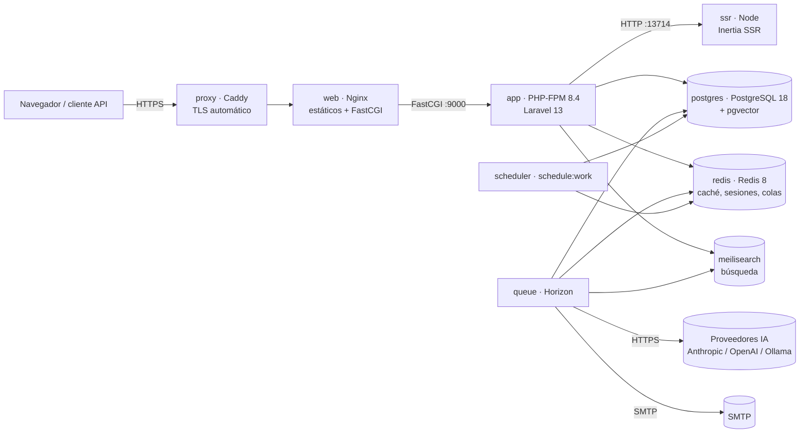
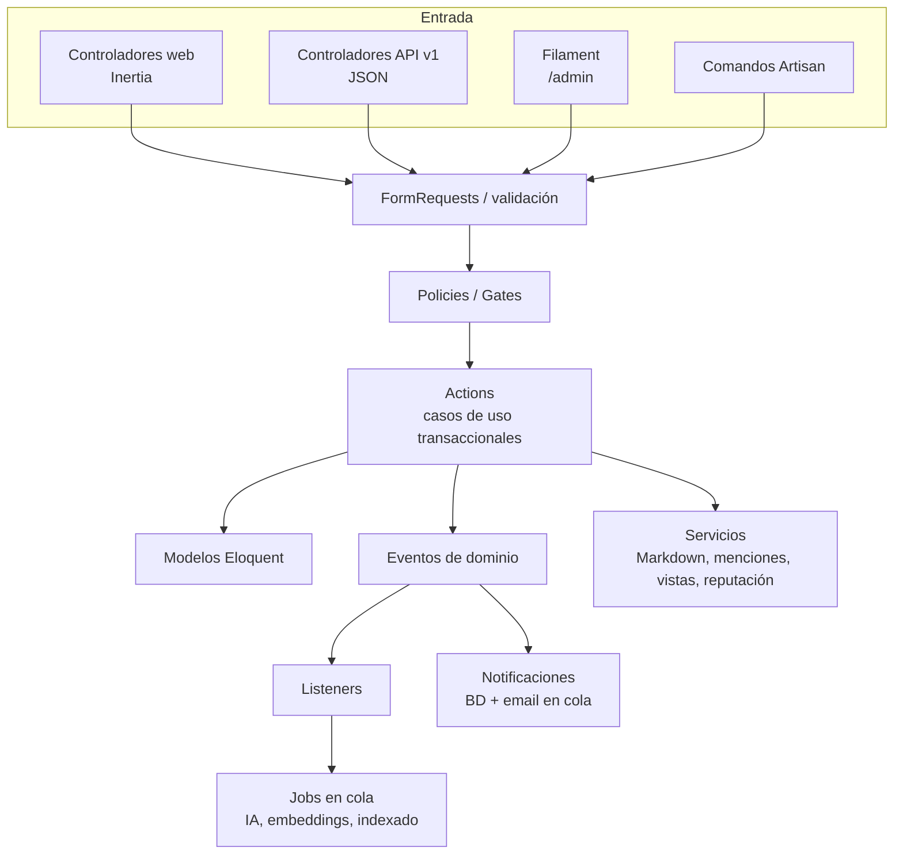
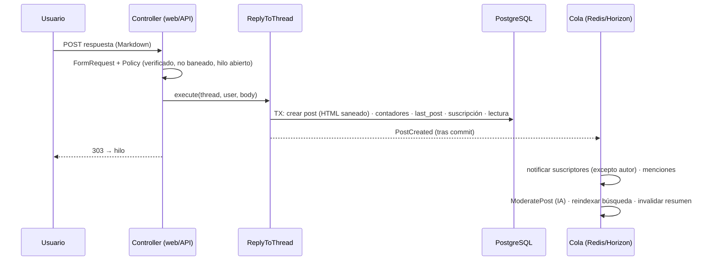
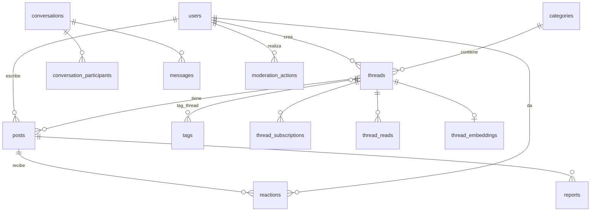

# Especificación de diseño y arquitectura

> Estado: **aprobada** por el propietario del proyecto · Fecha: 2026-10-22
>
> Este documento es la especificación de diseño de la reconstrucción del foro. Una vez
> aprobado, sirve como documento de arquitectura del proyecto y se mantiene actualizado.

## 1. Objetivo y alcance

**Qué es.** Un foro web de comunidad, multilingüe (español e inglés), con:
- interfaz web SPA renderizada en servidor (SSR) para SEO;
- API REST versionada para clientes externos (apps móviles, bots, integraciones);
- panel de administración y moderación;
- funcionalidades asistidas por IA.

**Para quién.**
- **Visitantes**, que leen y buscan.
- **Miembros**, que publican, reaccionan y conversan.
- **Moderadores**, que mantienen la calidad.
- **Administradores**, que configuran el foro.

**Criterios de éxito.**

1. Cubre las funcionalidades habituales de un foro real (sección 4).
2. Toda la lógica de negocio se comparte entre la web y la API: no hay reglas duplicadas.
3. Tests automatizados con cobertura medida:
   - **PHP: ≥ 95 % de líneas** sobre `app/`, exigido en CI;
   - **TypeScript: ≥ 90 %** sobre componentes, *composables* y utilidades.
4. Entorno local y de producción 100 % Docker con un contenedor por servicio. El entorno
   local se levanta con un único comando.
5. Las funcionalidades de IA son opcionales:
   - el foro funciona igual sin claves de proveedor;
   - un fallo del proveedor nunca bloquea una publicación.
6. Documentación suficiente para que una persona nueva levante el proyecto, entienda la
   arquitectura y lo despliegue.

## 2. Decisiones confirmadas

| Tema | Decisión | Motivo |
|---|---|---|
| Framework | **Laravel 13** (≥ 13.38) sobre **PHP 8.4** | Versión estable actual; PHP 8.4 permite Pest 5 y está en soporte activo. CI también prueba PHP 8.5. |
| Frontend | **Inertia 3 + Vue 3 + TypeScript** (base: *starter kit* oficial de Vue) | Continuidad con Vue (elección del propietario). Inertia 3 es la versión actual del mismo stack. |
| Renderizado | **SSR de Inertia** en un contenedor Node propio | SEO, imprescindible en un foro. Si el SSR cae, Inertia sirve la página en modo cliente sin romperse. |
| Base de datos | **PostgreSQL 18 + pgvector** | Búsqueda vectorial nativa en Laravel 13 (`vector`, `whereVectorSimilarTo`). La suite rápida sigue funcionando en SQLite. |
| Admin | **Filament 5** en `/admin` | CRUD, tablas, filtros y acciones masivas con poco código. Convive con Inertia (usa Livewire 4 solo en el panel). |
| Idioma | UI bilingüe **es/en** (español por defecto); documentación en español; código en inglés | Comunidad hispanohablante con apertura internacional. Las traducciones (`lang/*.json`) se comparten entre Laravel y Vue. |
| IA | **SDK oficial `laravel/ai`** | Independiente del proveedor, con *fakes* para tests, *embeddings* y salida estructurada. |
| Búsqueda | **Laravel Scout + Meilisearch** | Relevancia y tolerancia a erratas de calidad; servicio propio en Docker. |
| Colas | **Redis + Laravel Horizon** | Supervisión de colas en producción (`/horizon`, solo administradores). |

## 3. Stack tecnológico

**Backend**
- laravel/framework 13 e inertiajs/inertia-laravel 3.
- Autenticación: laravel/fortify 1.41 (login, registro, verificación de email,
  restablecimiento de contraseña, 2FA TOTP y *passkeys*) y laravel/sanctum 4 (tokens de
  API con *abilities*).
- laravel/wayfinder (rutas tipadas para TypeScript).
- Búsqueda: laravel/scout 11 con meilisearch/meilisearch-php.
- IA y colas: laravel/ai 1.3 y laravel/horizon 5.
- filament/filament 5 y dedoc/scramble (OpenAPI 3.1).
- Utilidades: league/commonmark (Markdown seguro) e intervention/image 4 (procesado
  nativo de imágenes de Laravel 13, para los avatares).

**Frontend**
- Vue 3.5 + TypeScript.
- @inertiajs/vue3 3 y @inertiajs/vite.
- Interfaz: Tailwind CSS 4 (con *typography*), shadcn-vue sobre Reka UI, Lucide y
  vue-sonner.
- laravel-vue-i18n (comparte `lang/*.json` con Laravel) y @vueuse/core.
- Vite 8.

**Calidad**
- PHP: Pest 5 (unit, feature y arquitectura) con pcov, Larastan (PHPStan nivel 7) y Laravel
  Pint.
- TypeScript: Vitest con @vue/test-utils y cobertura v8, ESLint, Prettier y vue-tsc.

**Infraestructura**
- Docker con Dockerfile *multi-stage*:
  - imágenes `app` (PHP-FPM) y `web` (Nginx con los assets);
  - imagen `ssr` (Node con el bundle SSR autocontenido);
  - imagen `dev`.
- Docker Compose para local (`compose.yaml`) y producción (`compose.prod.yaml`).
- Caddy como proxy TLS en producción.
- GitHub Actions y GHCR como registro de imágenes.

## 4. Funcionalidades

### 4.1 Cuentas y perfiles

- **Registro:**
  - campos: nombre visible, *username* único (`[a-z0-9_-]`, 3–30), email y contraseña;
  - verificación de email obligatoria para publicar.
- **Acceso:**
  - login con email o *username*;
  - recordarme;
  - restablecimiento de contraseña;
  - confirmación de contraseña para acciones sensibles;
  - **2FA (TOTP + códigos de recuperación)** y ***passkeys*** (WebAuthn), heredados del
    *starter kit*.
- **Perfil público** (`/u/{username}`):
  - avatar (redimensionado a 256×256 WebP), biografía, ubicación y web;
  - rol, reputación, fecha de alta y última actividad;
  - pestañas de hilos y respuestas.
- **Ajustes:**
  - perfil, seguridad (contraseña, 2FA, *passkeys*) y apariencia (claro/oscuro/sistema);
  - preferencias de notificación por email, idioma y **tokens de API** (crear y revocar,
    con *abilities*);
  - **eliminar cuenta**: se anonimiza (se borran los datos personales y el avatar) y los
    mensajes del foro se conservan como «Usuario eliminado».
- **Roles:** `member`, `moderator` y `admin`.
- **Baneos:**
  - temporales o permanentes, con motivo;
  - el usuario baneado puede leer pero no publicar;
  - al banear se revocan sus tokens de API.
- **Reputación:**
  - +1 por cada reacción recibida;
  - +15 si su respuesta se marca como solución;
  - es reversible al retirar la reacción o desmarcar la solución.

### 4.2 Estructura del foro

- **Categorías:**
  - nombre, slug, descripción, color, icono y orden;
  - opción «bloqueada»: solo el *staff* abre hilos (p. ej. «Anuncios»);
  - contadores desnormalizados de hilos y mensajes.
- **Etiquetas:**
  - las crea el *staff*; los miembros eligen hasta 5 por hilo;
  - filtran listados transversalmente.
- **Hilos:**
  - título y slug único y estable (`/t/{slug}`);
  - el primer mensaje es el cuerpo del hilo (modelo «hilo = primer post», como en
    Discourse), lo que unifica edición, reacciones y reportes;
  - estados: fijado (*sticky*), cerrado (*locked*), resuelto (con solución) y pendiente de
    revisión;
  - contadores de respuestas y vistas; la vista se cuenta una vez por visitante y hora.
- **Respuestas:**
  - Markdown (GFM: tablas, listas de tareas, código) renderizado en servidor y saneado;
  - **menciones** `@usuario` con enlace y notificación;
  - responder citando un mensaje concreto;
  - edición con indicador «editado»;
  - borrado lógico (*soft delete*) restaurable por el *staff*.
- **Reacciones:** 👍 me gusta, ❤️ me encanta, 😂 divertido, 💡 útil y 🎉 celebro. Alternables
  por usuario; no se reacciona a mensajes propios.
- **Solución:** el autor del hilo o el *staff* marca la respuesta que resuelve la pregunta.
- **Suscripciones:**
  - seguir y dejar de seguir un hilo;
  - suscripción automática al crear o responder.
- **Lectura:**
  - marcas de «no leído» por usuario e hilo (badge «nuevo»);
  - al abrir el hilo se salta al primer mensaje no leído.
- **Listados:**
  - orden: última actividad, más recientes, más respondidos y sin respuesta;
  - filtros: categoría, etiqueta, resueltos, sin resolver, «que sigo» y «míos»;
  - los fijados aparecen primero en su categoría;
  - paginación.
- **Portada:**
  - categorías con estadísticas y último hilo;
  - últimos hilos;
  - estadísticas globales (miembros, hilos, mensajes, último registrado);
  - usuarios activos en los últimos 15 minutos.
- **Búsqueda** (`/search`):
  - hilos y mensajes, con filtros por categoría y etiqueta;
  - solo contenido visible y no borrado.
- **SEO:**
  - SSR con `<title>`, descripción, canónica y Open Graph por página;
  - `sitemap.xml` (categorías e hilos) y `robots.txt`.

### 4.3 Mensajes privados

- Conversaciones con uno o varios participantes: asunto, mensajes en Markdown y marcas de
  leído.
- Abandonar una conversación.
- Preferencia para no recibir mensajes privados.
- Límite de envío para frenar el spam.

### 4.4 Notificaciones

- **Canal base de datos** (campana con contador; página `/notifications`; marcar una o
  todas como leídas):
  - nueva respuesta en un hilo seguido;
  - mención;
  - tu respuesta fue marcada como solución;
  - nuevo mensaje privado;
  - tu mensaje fue moderado (ocultado o aprobado).
- **Canal email** (en cola), configurable por tipo en los ajustes.

### 4.5 Moderación

- **Reportes de usuarios**:
  - motivos: spam, abuso, fuera de tema, ilegal u otro;
  - un reporte abierto por usuario y mensaje;
  - cola de reportes para el *staff*.
- **Acciones de *staff*:**
  - fijar o desfijar, cerrar o abrir y mover hilos;
  - ocultar o aprobar mensajes y borrar o restaurar;
  - resolver o descartar reportes;
  - banear o desbanear;
  - cambiar roles (solo administradores).
- **Registro de moderación** (auditoría): quién, qué, sobre qué, cuándo y por qué.
- **Antispam:**
  - límites de publicación por usuario (hilos, respuestas, reportes, mensajes privados y
    reacciones);
  - verificación de email;
  - moderación automática por IA (4.6).

### 4.6 Funcionalidades de IA (`laravel/ai`)

| Funcionalidad | Cómo funciona | Seguridad y coste |
|---|---|---|
| **Moderación automática** | Un *job* en cola clasifica cada mensaje nuevo o editado con un agente de salida estructurada: `{veredicto: allow/review/block, categorías, confianza, motivo}`. `block` con confianza ≥ 0,8 oculta el mensaje (pendiente de revisión) y crea un reporte «IA»; `review` crea el reporte sin ocultar. | Post-moderación: publicar nunca espera a la IA. Si el proveedor falla, el mensaje queda publicado y el *job* reintenta. La salida se valida (enumerados y rangos) antes de actuar. |
| **Resumen de hilos (TL;DR)** | Disponible a partir de 5 respuestas. Un agente genera un resumen en el idioma del hilo (pregunta, respuestas principales, consenso o solución). Se guarda en el hilo y se regenera solo si hay ≥ 3 respuestas nuevas o han pasado 24 h. | La salida del modelo se trata como no confiable: se renderiza con el mismo Markdown saneado. Límite de peticiones por usuario. |
| **Hilos similares** | *Embeddings* del título y del inicio del primer mensaje en `thread_embeddings` (pgvector, índice HNSW). Se muestran «hilos relacionados» en cada hilo y sugerencias mientras se escribe el título de uno nuevo, para evitar duplicados. | Sin pgvector (p. ej. SQLite) se usa búsqueda por palabras clave. Los *embeddings* se generan en cola y solo si cambia el contenido (hash). |
| **Sugerencia de etiquetas** | Al crear un hilo, un agente elige hasta 3 etiquetas **de las existentes** a partir del título y el cuerpo. | Las etiquetas devueltas que no existen se descartan. |

- **Proveedores por defecto** (todo configurable por variables de entorno):
  - texto: Anthropic con `claude-opus-5-5`, ajustable por funcionalidad (p. ej.
    `claude-haiku-5-5` para moderación de alto volumen);
  - *embeddings*: OpenAI `text-embedding-3-small` (1536 dimensiones).
- **Alternativa local sin claves:** perfil opcional de Docker con **Ollama**.
- **Desactivación:** con `FORUM_AI_ENABLED=false` (valor por defecto en `.env.example`)
  toda la IA queda apagada.
- **Mitigaciones contra *prompt injection*:**
  - el contenido de usuario va delimitado y se instruye al modelo para tratarlo como datos;
  - las acciones derivadas son acotadas (nunca se borra contenido, solo se oculta para
    revisión humana).

### 4.7 API REST v1

- **Ubicación y documentación:** `/api/v1`, documentada en OpenAPI 3.1 con Scramble
  (`/docs/api`).
- **Autenticación:**
  - tokens Sanctum con *abilities* `read`, `write`, `messages` y `moderate` (esta última
    solo para el *staff*);
  - `POST /auth/token` emite tokens y **exige el código 2FA** si el usuario lo tiene
    activado.
- **Endpoints principales:**
  - categorías y etiquetas;
  - hilos (listar con filtros, crear, ver, editar y borrar);
  - mensajes (listar, responder, editar y borrar);
  - reacciones (`PUT` y `DELETE` idempotentes), solución, suscripción y reportes;
  - notificaciones, conversaciones, perfiles públicos y búsqueda;
  - acciones de moderación;
  - IA: resumen y hilos similares.
- **Convenciones:**
  - recursos JSON con paginación (`data`, `links`, `meta`);
  - errores en el formato estándar de Laravel (`message` y `errors`);
  - *rate limiting*: 120/min autenticado y 60/min invitado, más límites de escritura;
  - el email solo se expone a su propietario.

### 4.8 Panel de administración (Filament 5, `/admin`)

- **Escritorio:** métricas (miembros, hilos, mensajes, reportes abiertos) y gráfico de
  actividad.
- **Recursos:** categorías (con orden), etiquetas, usuarios (rol y baneo), hilos, mensajes,
  reportes (cola) y registro de moderación (solo lectura).
- **Acceso:**
  - administradores: todo;
  - moderadores: hilos, mensajes, reportes, registro y baneo de miembros.
- **Otros paneles:** Horizon en `/horizon`, solo administradores.

## 5. Roles y permisos

| Acción | Invitado | Miembro sin verificar | Miembro | Moderador | Admin |
|---|:-:|:-:|:-:|:-:|:-:|
| Leer y buscar | ✓ | ✓ | ✓ | ✓ | ✓ |
| Crear hilo / responder | | | ✓¹ | ✓ | ✓ |
| Editar / borrar lo propio | | | ✓² | ✓ | ✓ |
| Reaccionar, reportar, seguir, mensajes privados | | | ✓³ | ✓ | ✓ |
| Marcar solución | | | autor del hilo | ✓ | ✓ |
| Fijar, cerrar, mover, ocultar, aprobar, restaurar | | | | ✓ | ✓ |
| Banear | | | | miembros | todos salvo admins |
| Categorías, etiquetas y roles | | | | | ✓ |
| `/admin` | | | | moderación | completo |
| `/horizon` | | | | | ✓ |

1. No baneado. En categorías bloqueadas, solo el *staff*.
2. No se edita en hilos cerrados. El autor puede borrar su hilo si aún no tiene respuestas.
3. No sobre contenido propio (reaccionar y reportar).

## 6. Arquitectura

### 6.1 Contenedores

- **En local** se añaden `mailpit` (SMTP de pruebas con interfaz web) y `vite` (servidor de
  desarrollo con HMR); `ollama` es opcional (perfil `ai`).
- **En local no hay proxy:** Nginx publica en `127.0.0.1:8080`.
- **En producción** el proxy publica 80/443. El resto solo es accesible en redes internas:
  `edge` (proxy↔web), `app` (web↔app↔ssr) y `data` (servicios de datos, sin salida a
  Internet).

### 6.2 Capas de la aplicación

- **Actions** (`app/Actions/...`): un caso de uso por clase (`CreateThread`,
  `ReplyToThread`, `ToggleReaction`, `BanUser`…). Son la única vía para modificar el
  dominio, de modo que web, API, Filament y comandos comparten reglas, transacciones y
  eventos.
- **Policies:** toda la autorización. Las comprobaciones de *abilities* de tokens se hacen
  en la capa API.
- **Eventos de dominio:**
  - tipos: `ThreadCreated`, `PostCreated`, `PostUpdated`, `ReactionToggled`,
    `SolutionMarked`, `PostReported`…;
  - sus *listeners* hacen los efectos secundarios (notificar, indexar, IA), de modo que las
    acciones no conocen a sus consumidores.
- **Contadores desnormalizados:**
  - se mantienen dentro de las acciones (misma transacción);
  - el comando `forum:recount` los recalcula si hiciera falta.

### 6.3 Flujo de una respuesta

## 7. Modelo de datos

| Tabla | Columnas clave |
|---|---|
| `users` | `username` (único, minúsculas), `name`, `email`, `role`, `reputation`, `threads_count`, `posts_count`, `avatar_path`, `bio`, `location`, `website`, `locale`, `preferences` (JSON), `banned_at`, `banned_until`, `ban_reason`, `last_seen_at`, columnas de 2FA y *soft delete* |
| `categories` | `name`, `slug` (único), `description`, `color`, `icon`, `position`, `is_locked`, `threads_count`, `posts_count` |
| `tags` | `name`, `slug` (único), `color`, `threads_count` |
| `threads` | `category_id`, `user_id`, `title`, `slug` (único), `status` (`published`/`pending_review`/`hidden`), `is_pinned`, `is_locked`, `solution_post_id`, `first_post_id`, `last_post_id`, `last_posted_at` (índice), `replies_count`, `views_count`, `ai_summary`, `ai_summary_generated_at`, `ai_summary_replies_count` y *soft delete* |
| `posts` | `thread_id`, `user_id`, `reply_to_id`, `body` (Markdown), `body_html` (saneado), `status`, `edited_at`, `edited_by_id` y *soft delete* |
| `reactions` | `post_id`, `user_id`, `type`; único por (`post_id`, `user_id`, `type`) |
| `thread_subscriptions` / `thread_reads` | Pivotes únicos por (`thread_id`, `user_id`); `thread_reads.last_read_at` |
| `reports` | `post_id`, `reporter_id` (nulo si es IA), `source` (`user`/`ai`), `reason`, `details`, `ai_confidence`, `status` (`open`/`resolved`/`dismissed`), `resolved_by_id`, `resolved_at`, `resolution_note` |
| `moderation_actions` | `moderator_id` (nulo si es el sistema), `action`, `subject_type`/`subject_id`, `reason`, `meta` (JSON) |
| `thread_embeddings` | `thread_id` (PK), `embedding vector(N)` con índice HNSW (coseno), `model`, `content_hash`; solo en PostgreSQL |
| `conversations` / `conversation_participants` / `messages` | Asunto, `last_message_at`; participantes con `last_read_at` y `left_at`; mensajes con `body` y `body_html` |
| Infraestructura | `notifications`, `personal_access_tokens`, `passkeys`, `jobs`/`failed_jobs`, `cache`, `sessions` (en Redis en Docker) |

**Índices:**
- `threads (category_id, is_pinned, last_posted_at)`, `threads (status, last_posted_at)`;
- `posts (thread_id, created_at)`, `posts (user_id, created_at)`;
- `reports (status, created_at)`.

## 8. Interfaz web

| Ruta | Página | Notas |
|---|---|---|
| `/` | Portada | Categorías, últimos hilos, estadísticas y usuarios activos |
| `/threads` | Listado global | Filtros, orden y paginación |
| `/c/{categoría}` | Categoría | Fijados primero; botón «Nuevo hilo» |
| `/tags/{etiqueta}` | Listado filtrado | |
| `/t/{hilo}` | Hilo | Mensajes paginados; resumen IA y similares como *deferred props*; acciones de moderación en línea |
| `/threads/create` | Crear hilo | Editor Markdown con vista previa, etiquetas sugeridas e hilos similares mientras se escribe |
| `/u/{usuario}` | Perfil público | Pestañas de hilos y respuestas |
| `/search` | Búsqueda | Pestañas de hilos y mensajes |
| `/notifications` | Notificaciones | |
| `/messages`… | Mensajes privados | Bandeja, conversación y nueva conversación |
| `/settings/*` | Ajustes | Perfil, seguridad, notificaciones, tokens de API y apariencia |
| `/login`, `/register`… | Autenticación | Vistas Inertia de Fortify (*starter kit*) |

- **Rutas tipadas:** las URLs se generan con **Wayfinder** (`import { show } from
  '@/actions/...'`), sin cadenas sueltas.
- **i18n:** `laravel-vue-i18n` comparte `lang/es.json` y `lang/en.json`. El selector de
  idioma persiste la elección en el perfil o en la sesión.
- **SSR:** `resources/js/ssr.ts`, construido con `vite build --ssr` como bundle
  autocontenido que se ejecuta en el contenedor `ssr`.

## 9. Seguridad

| Amenaza | Mitigación |
|---|---|
| XSS en contenido de usuario y de IA | Markdown renderizado en servidor con CommonMark (`html_input: escape`, `allow_unsafe_links: false`), enlaces externos con `rel="nofollow ugc noopener"` y Vue solo usa `v-html` con HTML ya saneado. Tests específicos de XSS. |
| CSRF | Cookie XSRF de Inertia y middleware de Laravel. La API usa tokens Bearer (sin cookies). |
| Fuerza bruta y *credential stuffing* | Límites de Fortify en login y 2FA, *passkeys* y emisión de tokens limitada y sujeta a 2FA. |
| Escalada de privilegios | Policies en todas las acciones, *abilities* en tokens y *staff* comprobado en servidor (nunca en el cliente). Tests de autorización negativos. |
| Spam y abuso | Verificación de email, *rate limiting* por usuario, moderación por IA, reportes y baneos (con revocación de tokens). |
| Fugas de datos personales | Email solo para su propietario, IP no almacenada, anonimización al borrar la cuenta y avatares reprocesados (sin EXIF). |
| *Prompt injection* | Contenido delimitado, salida validada y acciones acotadas (sección 4.6). |
| Secretos | Solo en `.env` o en variables del orquestador. `APP_KEY` efímera en tests. Escaneo de dependencias semanal. |
| Cabeceras | Nginx y Caddy: `X-Content-Type-Options`, `Referrer-Policy`, `X-Frame-Options`, `Permissions-Policy` y HSTS en producción. |

## 10. Rendimiento

- **Lecturas:**
  - contadores desnormalizados (sin `COUNT(*)` en listados);
  - *eager loading* obligatorio (`preventLazyLoading` fuera de producción);
  - índices compuestos (sección 7).
- **Trabajo en segundo plano:** notificaciones, indexado, IA y procesado de imágenes en cola
  (Horizon).
- **Caché:** Redis para estadísticas de portada (TTL corto), *rate limiters* y
  de-duplicación de vistas.
- **PHP en producción:**
  - OPcache con `validate_timestamps=0`;
  - `php artisan optimize` (config, rutas, eventos y vistas) en el arranque del contenedor;
  - autoloader autoritativo.
- **Assets:** con *hash* y `Cache-Control: immutable` en Nginx; compresión gzip.

## 11. Estrategia de tests

| Capa | Herramienta | Qué se cubre |
|---|---|---|
| Unit | Pest | Markdown y XSS, menciones, enumerados, reglas de reputación, utilidades |
| Feature (web) | Pest + aserciones Inertia | Cada página y acción: *props*, validación, autorización (positivos y negativos), redirecciones |
| Feature (API) | Pest | Cada endpoint: auth, *abilities*, validación, autorización, formato, paginación, *rate limiting* |
| Dominio | Pest | Actions, eventos, *listeners*, *jobs*, notificaciones (`Notification::fake`), comandos y *scheduler* |
| IA | Pest + *fakes* de `laravel/ai` | Agentes simulados (`Agent::fake`, `Embeddings::fake`), umbrales, fallos y degradación |
| Admin | Pest + Livewire/Filament *testing* | Listados, formularios, acciones y control de acceso del panel |
| Arquitectura | Pest Arch | Sin `dd`/`dump`, *strict types*, capas (los controladores no usan modelos para escribir sin Actions), presets `laravel` y `security` |
| Frontend | Vitest + @vue/test-utils | Componentes del foro, *composables* y utilidades (cobertura ≥ 90 %) |
| Integración | CI (Docker) | *Smoke test* del stack de producción: imágenes construidas, migraciones, `/up` y portada SSR |

- **Bases de datos:**
  - la suite corre en **SQLite en memoria** (rápida, sin servicios);
  - en CI también corre en **PostgreSQL + pgvector**, con los tests de vectores
    activados;
  - la cobertura y el umbral se miden en el job de PostgreSQL.

## 12. Docker

**Imágenes** (un único `Dockerfile` *multi-stage*):

| *Target* | Base | Contenido |
|---|---|---|
| `dev` | `php:8.4-fpm-alpine` | Extensiones (`pdo_pgsql`, `redis`, `intl`, `gd`, `zip`, `pcntl`, `bcmath`, `opcache`), pcov y Xdebug (desactivado), Composer y Node (Vite y Wayfinder), usuario con el UID/GID del host |
| `app` | `php:8.4-fpm-alpine` | Producción: código, `vendor` sin dependencias de desarrollo, assets compilados, OPcache, usuario no root, *healthcheck* FastCGI y *entrypoint* que cachea la configuración |
| `web` | `nginx:alpine` | Configuración endurecida y `public/` con los assets compilados |
| `ssr` | `node:24-alpine` | Solo `bootstrap/ssr` (bundle autocontenido), usuario `node` |

**Servicios:**

| Servicio | Local (`compose.yaml`) | Producción (`compose.prod.yaml`) |
|---|---|---|
| `proxy` | — | Caddy (80/443, TLS automático) |
| `web` | Nginx con el código montado (`127.0.0.1:8080`) | Imagen `web` |
| `app` | Imagen `dev` con el código montado | Imagen `app` |
| `ssr` | Opcional (perfil `ssr`) | Imagen `ssr` |
| `queue` | `queue:listen` (recarga el código) | `horizon` |
| `scheduler` | `schedule:work` | `schedule:work` |
| `migrate` | — | *One-shot* `migrate --force` del que dependen `app` y `queue` |
| `vite` | `npm run dev` (HMR, `127.0.0.1:5173`) | — |
| `postgres` | pgvector/pg18 | pgvector/pg18 (red interna, volumen) |
| `redis` | redis:8 | redis:8 con contraseña |
| `meilisearch` | Meilisearch v1 | Meilisearch v1 con *master key* |
| `mailpit` | Interfaz web en `127.0.0.1:8025` | — (SMTP real) |
| `ollama` | Opcional (perfil `ai`) | — |

**Resto de la configuración:**
- *healthchecks* en todos los servicios y `depends_on` por estado `healthy`;
- volúmenes con nombre para datos y almacenamiento;
- en producción: límites de recursos, rotación de logs y `no-new-privileges`;
- **`Makefile`** con atajos: `make setup`, `make up`, `make test`, `make lint`,
  `make shell`, `make logs`…

## 13. CI/CD (GitHub Actions)

| Workflow | Jobs |
|---|---|
| `ci.yml` (PR y `main`) | `php-lint` (Pint y Larastan); `php-tests` (matriz: PHP 8.4 + PostgreSQL con cobertura y umbral ≥ 95 %; PHP 8.5 + SQLite); `js` (ESLint, Prettier, vue-tsc y Vitest con cobertura); `build` (Vite cliente y SSR); `docker` (*build* de las cuatro imágenes con caché y *smoke test* del stack de producción) |
| `audit.yml` | Se conserva: `composer audit` y `npm audit` con lista de excepciones, semanal y en cada push |
| `release.yml` | En *tags* `v*`: imágenes en GHCR (`app`, `web`, `ssr`) y despliegue opcional por SSH a un entorno protegido |
| `dependabot.yml` | composer, npm, github-actions y docker (semanal, agrupado) |

Todas las acciones se fijan por SHA y usan permisos mínimos.

## 14. Documentación entregable

- `README.md`: qué es, funcionalidades, stack, arranque rápido, comandos y enlaces.
- `docs/`:
  - `01-evaluacion-inicial.md` y `02-arquitectura.md` (este documento);
  - `03-desarrollo-local.md`, `04-despliegue.md`, `05-api.md` y `06-ia.md`;
  - `07-testing-y-ci.md` y `08-seguridad.md`.

## 15. Fuera de alcance (posible *roadmap*)

- Tiempo real por WebSockets (Laravel Reverb): las notificaciones se refrescan con
  *polling* ligero de Inertia.
- Adjuntos de ficheros e imágenes subidas en mensajes (se permiten imágenes por URL HTTPS en
  Markdown).
- Encuestas, insignias o logros, marcadores y borradores en servidor (el borrador de
  respuesta se guarda en el navegador).
- Login social (Socialite) y SSO.
- Historial de ediciones visible (se registra quién y cuándo editó).

## 16. Riesgos y mitigaciones

| Riesgo | Mitigación |
|---|---|
| Versiones muy recientes (Inertia 3, Vite 8, Filament 5, `laravel/ai` 1.x) | Versiones fijadas en los *lockfiles*, Dependabot agrupado y la suite completa como red de seguridad. |
| Coste de la IA | Desactivada por defecto, modelos configurables por funcionalidad, regeneración acotada, límites por usuario y *embeddings* en caché por hash. |
| Dimensión de *embeddings* ligada al modelo | Configurable (`FORUM_AI_EMBEDDINGS_DIMENSIONS`). Cambiarla exige regenerar los vectores; está documentado y existe un comando de *backfill*. |
| Divergencia entre SQLite y PostgreSQL | CI ejecuta ambos. El código específico de PostgreSQL está aislado tras una interfaz con alternativa. |
