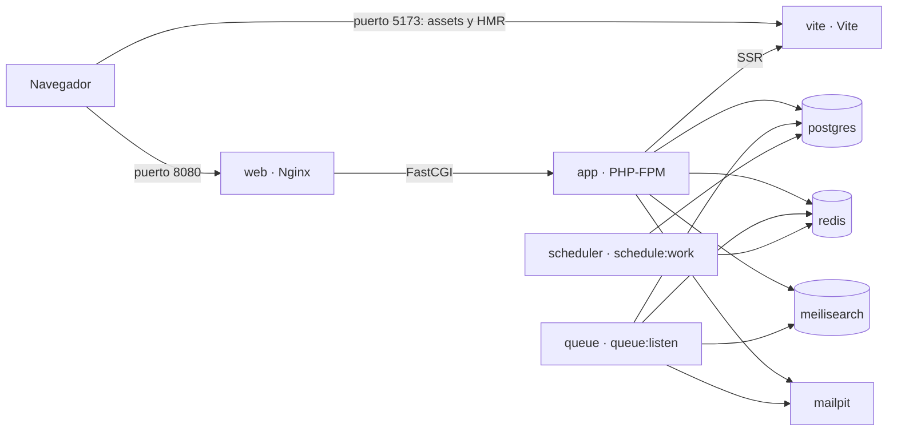

# Desarrollo local

El entorno de desarrollo es un conjunto de contenedores definido en
`compose.yaml`. El `Makefile` reúne los atajos de uso diario: `make help` los
lista. Todo lo que necesita el foro (PHP, Composer, Node y los servicios de
datos) vive en contenedores, así que en tu equipo basta con Docker.

## 1. Requisitos

- **Docker Engine 25 o posterior con Docker Compose v2.** En macOS y Windows,
  Docker Desktop. Probado con Docker Engine 29.9 y Compose 5.6.
- **GNU Make** y **Git**.
- Unos 4 GB de memoria libres para los contenedores.
- Libres en `127.0.0.1`: los puertos 8080 (foro), 5173 (Vite), 5432
  (PostgreSQL), 6379 (Redis), 7700 (Meilisearch) y 8025 (Mailpit). Si alguno
  está ocupado, cámbialo en el `.env` (ver la [sección 9](#9-puertos)).
- En Windows, trabaja dentro de WSL 2 y clona el repositorio en el sistema de
  ficheros de Linux: es mucho más rápido y Vite detecta los cambios.

## 2. Primer arranque

```bash
git clone https://github.com/jaisato/laravel-forum.git
cd laravel-forum
make setup
```

`make setup`:

1. copia `.env.example` en `.env` si aún no existe;
2. construye la imagen de desarrollo (`laravel-forum/dev`) con tu UID y GID;
3. levanta PostgreSQL, Redis, Meilisearch y Mailpit y espera a que estén sanos;
4. ejecuta `composer install`;
5. genera `APP_KEY` si el `.env` no tiene una;
6. enlaza `public/storage` (`php artisan storage:link --force`);
7. aplica las migraciones y, si la base de datos estaba vacía, siembra los
   datos de demostración;
8. sincroniza los ajustes de los índices de Meilisearch
   (`php artisan scout:sync-index-settings`);
9. ejecuta `npm ci`;
10. levanta todos los servicios y espera a que estén sanos.

La primera construcción de la imagen tarda varios minutos (descarga las
imágenes base y compila las extensiones de PHP); después, `make setup` tarda en
torno a un minuto. Se puede repetir sin riesgo, por ejemplo tras actualizar la
rama: no vuelve a sembrar una base de datos que ya tiene tablas.

Al terminar, el foro está en <http://localhost:8080>:

| Cuenta | Email | Contraseña |
|---|---|---|
| Administración | `admin@example.com` (`SEED_ADMIN_EMAIL`) | `password` (`SEED_ADMIN_PASSWORD`) |
| Moderación | `moderador@example.com` | `password` |
| Miembros de demostración | `ana@example.com`, `luis@example.com`, `marta@example.com`… | `password` |

Para dar el rol de administración a otra cuenta:

```bash
docker compose exec app php artisan forum:make-admin luis@example.com
```

## 3. Servicios



| Servicio | Imagen | En tu equipo | Función |
|---|---|---|---|
| `app` | `laravel-forum/dev` | — | PHP-FPM con el código montado |
| `web` | `nginx:1.29-alpine3.23` | `127.0.0.1:8080` | Sirve `public/` y pasa el resto a `app` (`docker/nginx/nginx.conf`) |
| `vite` | `laravel-forum/dev` | `127.0.0.1:5173` | Servidor de desarrollo de Vite con recarga en caliente y SSR |
| `queue` | `laravel-forum/dev` | — | `queue:listen` de las colas `default` y `ai` |
| `scheduler` | `laravel-forum/dev` | — | `schedule:work`: las tareas de `routes/console.php` |
| `postgres` | `pgvector/pgvector:pg18` | `127.0.0.1:5432` | Bases de datos `forum` y `forum_testing`, con pgvector |
| `redis` | `redis:8-alpine` | `127.0.0.1:6379` | Caché, sesiones, colas y límites de frecuencia |
| `meilisearch` | `getmeili/meilisearch:v1.24` | `127.0.0.1:7700` | Búsqueda de hilos y mensajes |
| `mailpit` | `axllent/mailpit:v1.27` | `127.0.0.1:8025` | Recoge todos los correos y los muestra en su web |
| `ssr` (perfil `ssr`) | `laravel-forum/dev` | — | El bundle SSR de producción (ver la [sección 5](#5-frontend-vite-wayfinder-y-ssr)) |
| `ollama` (perfil `ai`) | `ollama/ollama:0.12.6` | — | Modelos locales para las funciones de IA, desactivadas por defecto |

Los puertos solo se publican en `127.0.0.1`. Los datos viven en volúmenes con
nombre (`postgres`, `redis`, `meilisearch`, `ollama`): sobreviven a
`make down`.

## 4. Trabajo diario

| Comando | Qué hace |
|---|---|
| `make up` | Arranca todo y espera a que esté sano |
| `make down` | Lo para; los datos se quedan en los volúmenes |
| `make ps` | Los contenedores y su estado de salud |
| `make logs` | Sigue los logs de todos los servicios; de uno: `make logs s=queue` |
| `make shell` | Una shell en el contenedor `app` |
| `make tinker` | El REPL de Laravel |
| `make migrate` | Aplica las migraciones pendientes |
| `make fresh` | Rehace la base de datos con los datos de demostración y sincroniza los índices |

Cualquier otro comando de Artisan, Composer o npm se ejecuta dentro del
contenedor `app`, que tiene la misma versión de PHP, las mismas extensiones y
el mismo Node que el resto del entorno:

```bash
docker compose exec app php artisan route:list
docker compose exec app composer require vendor/paquete
docker compose exec app npm install paquete
```

`node_modules` se instala dentro del contenedor, con binarios para Linux
(musl): no lo mezcles con un `npm install` hecho en tu equipo.

**Propietario de los ficheros.** Los contenedores de desarrollo se ejecutan con
tu UID y GID, así que lo que escriben en el código montado (`vendor`,
`node_modules`, cachés, logs) te pertenece. El `Makefile` los pasa en
`HOST_UID` y `HOST_GID`. Si usas `docker compose` sin `make` en Linux y tu UID
no es 1000, expórtalos antes de construir la imagen:

```bash
export HOST_UID="$(id -u)" HOST_GID="$(id -g)"
docker compose build
```

(Bash no exporta `UID`, de ahí los otros nombres.)

## 5. Frontend: Vite, Wayfinder y SSR

**Vite.** El servicio `vite` compila los assets con recarga en caliente.
Mientras se ejecuta, `public/hot` contiene `http://localhost:5173` y Laravel
sirve los scripts y estilos desde ahí; al pararse, Vite borra ese fichero.

**Wayfinder.** El plugin de Vite vuelve a generar las rutas tipadas
(`resources/js/actions` y `resources/js/routes`) cuando cambian las rutas o los
controladores. Son ficheros generados: no se versionan.

**SSR en desarrollo.** Laravel renderiza las páginas en el servidor a través
del propio contenedor de Vite (`INERTIA_SSR_HOT_URL=http://vite:5173`). Al
arrancar, Vite necesita unos segundos para preparar sus módulos; mientras
tanto las páginas se renderizan solo en el navegador y su log lo dice
(`SSR skipped, module graph is still warming up`).

**El bundle SSR de producción.** Para probarlo en local, compílalo, para Vite y
levanta el servicio `ssr`:

```bash
docker compose exec app npm run build:ssr
docker compose stop vite
docker compose --profile ssr up -d --wait ssr
```

Sin `public/hot`, Laravel usa los assets de `public/build` y renderiza con el
servicio `ssr` (`INERTIA_SSR_URL=http://ssr:13714`). Para volver al modo
habitual:

```bash
docker compose --profile ssr stop ssr
make up
```

## 6. Tests y calidad

| Comando | Qué hace |
|---|---|
| `make test` | Suite PHP con Pest, en paralelo y con SQLite en memoria |
| `make test-pgsql` | La misma suite sobre PostgreSQL 18 (base de datos `forum_testing`, una copia por proceso) |
| `make test-js` | Suite de Vitest |
| `make coverage` | Ambas suites con cobertura: PHP exige el 95 % y Vitest sus umbrales de `vitest.config.ts` |
| `make lint` | Pint, Larastan, ESLint, Prettier, vue-tsc y hadolint |
| `make fix` | Corrige el estilo con Pint, ESLint y Prettier |

Para ejecutar solo una parte:

```bash
docker compose exec app php artisan test --filter=TrustedProxies
docker compose exec app vendor/bin/pest tests/Feature/HealthTest.php
docker compose exec app npx vitest run tests/js/lib/inertia.spec.ts
```

El informe HTML de la cobertura de Vitest queda en `coverage/js/index.html`.
La suite PHP también funciona sin Docker: ver el [README](../README.md#tests-sin-docker).

## 7. Correo, búsqueda, colas y tareas programadas

- **Correo.** Todo lo que envía el foro llega a Mailpit:
  <http://localhost:8025>.
- **Búsqueda.** Meilisearch responde en <http://localhost:7700> con la clave
  `MEILISEARCH_KEY` del `.env`. Los índices se mantienen solos (Scout, en cola);
  para rehacerlos:

  ```bash
  docker compose exec app php artisan scout:sync-index-settings
  docker compose exec app php artisan scout:import "App\Models\Thread"
  docker compose exec app php artisan scout:import "App\Models\Post"
  ```

- **Colas.** `queue` atiende las colas `default` y `ai` con `queue:listen`, que
  carga el código de nuevo en cada trabajo: los cambios se aplican sin
  reiniciar nada. Los trabajos fallidos:

  ```bash
  docker compose exec app php artisan queue:failed
  docker compose exec app php artisan queue:retry all
  ```

- **Tareas programadas.** `scheduler` ejecuta `schedule:work`; para verlas:
  `docker compose exec app php artisan schedule:list`.

## 8. Depuración con Xdebug

La imagen de desarrollo trae Xdebug apagado (`xdebug.mode=off`, ver
`docker/php/conf.d/dev.ini`). Para depurar peticiones web, crea un
`compose.override.yaml` (git lo ignora; Docker Compose lo carga solo):

```yaml
services:
  app:
    environment:
      XDEBUG_MODE: debug
```

Después, `docker compose up -d app`. Tu IDE debe escuchar en el puerto 9003 y
asociar `/var/www/html` con la carpeta del proyecto. Xdebug se activa solo
cuando la petición lo pide (`xdebug.start_with_request=trigger`): con la
extensión *Xdebug helper* del navegador o la cookie `XDEBUG_TRIGGER`. Para un
comando de Artisan:

```bash
docker compose exec -e XDEBUG_MODE=debug -e XDEBUG_TRIGGER=1 app php artisan forum:recount
```

## 9. Puertos

El `.env` decide los puertos que `compose.yaml` publica en `127.0.0.1`:

```dotenv
APP_PORT=8080
FORWARD_DB_PORT=5432
FORWARD_REDIS_PORT=6379
FORWARD_MEILISEARCH_PORT=7700
FORWARD_MAILPIT_DASHBOARD_PORT=8025
```

Si cambias `APP_PORT`, cambia también `APP_URL`. Vite usa siempre el 5173.

## 10. Problemas frecuentes

**«port is already allocated» al arrancar.** Otro proceso usa ese puerto:
cámbialo en el `.env` (sección anterior) y repite `make up`.

**Errores de permisos en `vendor`, `node_modules` o `storage`.** La imagen se
construyó con otro UID o GID. Reconstrúyela con los tuyos (`make setup` lo
hace) o exporta `HOST_UID` y `HOST_GID` como en la
[sección 4](#4-trabajo-diario).

**La página carga sin estilos ni scripts.** `public/hot` apunta a un Vite que ya
no se ejecuta (por ejemplo, tras matar el contenedor). `make up` vuelve a
levantarlo; si no lo quieres, borra `public/hot`.

**`make test-pgsql` dice que `forum_testing` no existe.** El script de
`docker/postgres/init` solo se ejecuta cuando el volumen de PostgreSQL está
vacío. Créala a mano (las migraciones añaden la extensión `vector`):

```bash
docker compose exec postgres psql -U forum -d forum -c 'CREATE DATABASE forum_testing'
```

**Empezar de cero.** Esto **borra todos los datos** de los volúmenes:

```bash
docker compose down -v
make setup
```
