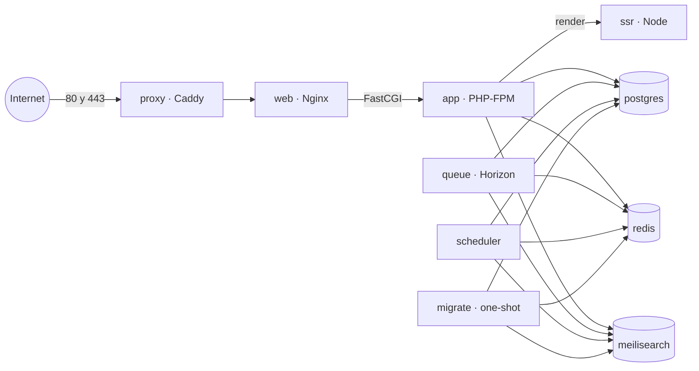

# Despliegue en producción

El foro se despliega con Docker Compose: `compose.prod.yaml` define los
servicios y `.env.production` su configuración. Esta guía cubre un servidor con
Docker; las imágenes son las mismas para cualquier otro orquestador.

## 1. Arquitectura



| Servicio | Imagen | Redes | Función |
|---|---|---|---|
| `proxy` | `caddy:2.11-alpine` | `edge` | HTTPS con certificados automáticos, HTTP/3, compresión y HSTS. El único que publica puertos (80 y 443) |
| `web` | `…-web` | `edge`, `app` | Nginx: `public/`, los assets compilados y los avatares; el resto, a `app` |
| `app` | `…-app` | `app`, `data` | PHP-FPM con Laravel |
| `ssr` | `…-ssr` | `app` | Servidor SSR de Inertia (Node) |
| `queue` | `…-app` | `app`, `data` | Horizon: las colas `default` y `ai` |
| `scheduler` | `…-app` | `app`, `data` | `schedule:work` |
| `migrate` | `…-app` | `app`, `data` | En cada despliegue, antes que nadie: migraciones y ajustes de los índices de Meilisearch |
| `postgres` | `pgvector/pgvector:pg18` | `data` | PostgreSQL 18 con pgvector |
| `redis` | `redis:8-alpine` | `data` | Caché, sesiones, colas y modo mantenimiento; con contraseña y AOF |
| `meilisearch` | `getmeili/meilisearch:v1.24` | `data` | Búsqueda, con clave maestra |

Las redes:

- `edge`: Internet, Caddy y Nginx.
- `app`: Nginx, PHP y SSR. Tiene salida a Internet porque PHP envía correo y
  llama a los proveedores de IA.
- `data`: los servicios de datos, **interna**: sin salida a Internet ni puertos
  publicados.

Los volúmenes con nombre guardan el estado: `storage` (los ficheros subidos,
como los avatares; Nginx lo monta en solo lectura), `postgres`, `redis`,
`meilisearch` y `caddy_data`/`caddy_config` (certificados y cuenta ACME).

Cada arranque sigue este orden: los servicios de datos quedan sanos, `migrate`
termina con éxito, arrancan `app`, `queue` y `scheduler`, después `web` y por
último `proxy`. Si las migraciones fallan, no arranca nada que dependa de ellas
(por eso, al actualizar, se ejecutan antes por separado: sección 4).

## 2. Requisitos

- Un servidor Linux **x86_64 (amd64)** con **Docker Engine 25 o posterior y
  Docker Compose v2**. Para una comunidad pequeña bastan 2 vCPU y 4 GB de
  memoria. Las imágenes publicadas son solo para amd64: en un servidor arm64,
  constrúyelas allí mismo (sección 8).
- Un dominio cuyos registros DNS (A/AAAA) apunten al servidor, y abiertos los
  puertos 80/TCP y 443/TCP (y 443/UDP para HTTP/3).
- Un servidor SMTP para el correo.

## 3. Primer despliegue

**1. Los ficheros.** El servidor necesita `compose.prod.yaml`,
`docker/caddy/Caddyfile` y la plantilla del entorno; lo más sencillo es clonar
el repositorio:

```bash
git clone https://github.com/jaisato/laravel-forum.git
cd laravel-forum
cp .env.production.example .env.production
chmod 600 .env.production
```

**2. La configuración.** Completa `.env.production`; como mínimo:

| Variable | Valor |
|---|---|
| `SERVER_NAME` | El dominio, sin esquema (`foro.example.com`) |
| `ACME_EMAIL` | El email de la cuenta ACME de los certificados |
| `APP_URL` | `https://` y el dominio |
| `APP_KEY` | Una clave nueva (abajo) |
| `DB_PASSWORD`, `REDIS_PASSWORD`, `MEILISEARCH_KEY` | Secretos largos y aleatorios (la clave de Meilisearch, de 16 bytes o más) |
| `MAIL_*` | Tu servidor SMTP |
| `IMAGE_PREFIX`, `IMAGE_TAG` | De dónde vienen las imágenes y qué versión |

Compose interpreta los `$` de `.env.production` (lo lee con `--env-file`): un
valor que lleve uno, como una contraseña de SMTP, va entre comillas simples
(`MAIL_PASSWORD='Xy$z9Q'`). Para generar los secretos:

```bash
echo "base64:$(openssl rand -base64 32)"   # APP_KEY
openssl rand -hex 24                       # cada contraseña o clave
```

`compose.prod.yaml` lee `.env.production` dos veces: para sus propias variables
(`--env-file`) y como entorno de los contenedores de PHP. Para no repetir las
opciones, conviene una función (en el `~/.bashrc` de quien opera el servidor,
por ejemplo), que añade además los ajustes propios del servidor,
`compose.prod.local.yaml`, si existen ([sección 9](#9-capacidad)):

```bash
dcp() {
    if [ -f compose.prod.local.yaml ]; then
        docker compose -f compose.prod.yaml -f compose.prod.local.yaml --env-file .env.production "$@"
    else
        docker compose -f compose.prod.yaml --env-file .env.production "$@"
    fi
}
```

Como todos los comandos de esta guía, se ejecuta en el directorio del clon.

**3. Las imágenes.** Descarga las publicadas en el registro de `IMAGE_PREFIX`,
o constrúyelas en el servidor desde el `Dockerfile` (ver la
[sección 8](#8-construir-las-imágenes)):

```bash
dcp pull    # imágenes publicadas
dcp build   # o construidas aquí
```

**4. El arranque.**

```bash
dcp up -d --wait
```

En el primer arranque Caddy obtiene el certificado: el DNS debe apuntar ya al
servidor y los puertos 80 y 443 deben estar abiertos.

**5. La primera cuenta de administración.** Regístrate en el foro y date el
rol:

```bash
dcp exec app php artisan forum:make-admin tu-email@example.com
```

**6. La comprobación.**

```bash
dcp ps -a
curl -fsS https://foro.example.com/up
```

Todos los servicios deben aparecer `healthy` salvo `migrate`, que termina con
`Exited (0)`.

## 4. Actualizar

Cada versión es un *tag* del repositorio (`v1.2.3`) y unas imágenes con su
número (`1.2.3`). Para pasar a otra, el código del servidor y `IMAGE_TAG`
cambian juntos, de modo que `compose.prod.yaml` y el `Caddyfile` sean los de
esas imágenes:

```bash
git fetch --tags
git checkout v1.2.3
sed -i 's/^IMAGE_TAG=.*/IMAGE_TAG=1.2.3/' .env.production
dcp pull
dcp run --rm migrate
dcp up -d --wait
dcp exec proxy caddy reload --config /etc/caddy/Caddyfile
```

Es lo mismo que hace el despliegue automático de la
[sección 10](#10-publicar-una-versión).

- **Primero las migraciones.** `run --rm migrate` las aplica mientras la
  versión anterior sigue atendiendo. Si fallan, detente ahí: no se ha
  sustituido nada, y basta con volver al *tag* y al `IMAGE_TAG` anteriores. Sin ese paso,
  `up` pararía `app`, `queue` y `scheduler` antes de ejecutar `migrate`, y una
  migración fallida dejaría el foro sin servicio.
- **Migraciones compatibles.** Como la versión anterior convive un momento con
  el esquema nuevo, cada migración tiene que funcionar con las dos (añadir una
  columna, sí; renombrarla o borrarla, en una versión posterior). Si no es
  posible, o si una migración bloquea tablas grandes, activa antes el modo
  mantenimiento (`dcp exec app php artisan down`) y desactívalo al final
  (`dcp exec app php artisan up`).
- **La sustitución.** `up` recrea los contenedores cuya imagen cambió (el
  servicio `migrate` vuelve a ejecutarse, ya sin nada pendiente). Horizon termina
  los trabajos en curso antes de pararse (dispone de 200 s) y, mientras se
  sustituye `app`, hay una breve interrupción.
- **El `Caddyfile`.** `up` deja como están los contenedores cuya definición no
  cambió, y Caddy lee su fichero solo al arrancar: `caddy reload` aplica el de
  la versión nueva sin cortar conexiones. Si tiene un error, Caddy lo rechaza y
  sigue con el anterior.

Volver a la versión anterior es repetir los mismos pasos con su *tag*. Las
migraciones **no** se deshacen solas: escríbelas compatibles con la versión
anterior o restaura la copia de seguridad.

## 5. Operación diaria

| Tarea | Comando |
|---|---|
| Estado de los servicios | `dcp ps` |
| Logs | `dcp logs -f --tail=100 app queue` |
| Cualquier comando de Artisan | `dcp exec app php artisan about` |
| Estado de Horizon | `dcp exec queue php artisan horizon:status` |
| Trabajos fallidos | `dcp exec app php artisan queue:failed` y `dcp exec app php artisan queue:retry all` |
| Modo mantenimiento | `dcp exec app php artisan down` y `dcp exec app php artisan up` |
| Rehacer los índices de búsqueda | `dcp exec app php artisan scout:import "App\Models\Thread"` (y `"App\Models\Post"`) |

El modo mantenimiento se guarda en Redis (`APP_MAINTENANCE_DRIVER=cache`), así
que activarlo desde un contenedor afecta a todos. El panel de Horizon está en
`/horizon`, solo para la administración.

## 6. Copias de seguridad

**Base de datos.**

```bash
dcp exec -T postgres pg_dump -U forum -Fc forum > forum-$(date +%F).dump
```

Para restaurarla, para antes lo que escribe en ella:

```bash
dcp stop app queue scheduler
dcp exec -T postgres pg_restore -U forum -d forum --clean --if-exists --no-owner < forum-2026-10-23.dump
dcp start app queue scheduler
```

**Ficheros subidos** (el volumen `storage`; el prefijo es el nombre del
proyecto, `laravel-forum-prod`):

```bash
docker run --rm -v laravel-forum-prod_storage:/data:ro -v "$PWD":/backup alpine:3.24 \
    tar czf /backup/storage-$(date +%F).tgz -C /data .
docker run --rm -v laravel-forum-prod_storage:/data -v "$PWD":/backup alpine:3.24 \
    tar xzf /backup/storage-2026-10-23.tgz -C /data
```

**Lo demás.** Los índices de Meilisearch se rehacen desde la base de datos
(sección anterior). Redis guarda en su volumen los trabajos en cola; la caché y
las sesiones se pueden perder. Copia también el volumen `caddy_data` (evita
volver a pedir los certificados) y, sobre todo, `.env.production`: sin su
`APP_KEY` no se puede leer nada de lo que Laravel cifró.

## 7. Seguridad

- Solo Caddy publica puertos. **Nunca publiques el puerto del servicio `ssr`**:
  el servidor SSR de Inertia también atiende `/shutdown`.
- La red `data` es interna; todos los servicios tienen `no-new-privileges`,
  límites de recursos y rotación de logs; `web` y `ssr` corren con el sistema
  de ficheros en solo lectura.
- Las imágenes propias no se ejecutan como root (`www-data`, `nginx` y `node`).
- Caddy añade HSTS; Nginx, `X-Content-Type-Options`, `X-Frame-Options`,
  `Referrer-Policy` y `Permissions-Policy`, y no anuncia versiones.
- Laravel solo cree la IP y el esquema que llegan en `X-Forwarded-For` y
  `-Proto` cuando vienen de `TRUSTED_PROXIES` (las redes privadas de Docker,
  en la plantilla), y nunca `X-Forwarded-Host` ni `-Port`: Caddy deja pasar el
  puerto que mande el cliente, que acabaría en los enlaces de los emails.
- `.env.production` contiene todos los secretos: permisos `600` y fuera de git
  (`.gitignore` lo excluye). Para cambiar `APP_KEY` sin invalidar lo cifrado,
  deja la anterior en `APP_PREVIOUS_KEYS` hasta que ya no haga falta.

## 8. Construir las imágenes

`dcp build` construye `app`, `web` y `ssr` desde el `Dockerfile` y las etiqueta
como `${IMAGE_PREFIX}-app:${IMAGE_TAG}` (y `-web`, `-ssr`). El nombre que
aparece en los títulos de las páginas se fija al construir: es `APP_NAME`.

Al construir solo se envía a Docker lo que las imágenes necesitan, la lista de
`.dockerignore`: lo demás que haya en el clon, como `.env.production`, las
copias de seguridad de la sección 6 o `compose.prod.local.yaml`, nunca entra
en una imagen.

Con `docker build`, una imagen cada vez y **las tres con los mismos
argumentos**: `app` lleva el *manifest* de los assets que sirve `web`, y un
`VITE_APP_NAME` distinto cambiaría sus nombres:

```bash
docker build --target app --build-arg VITE_APP_NAME="Laravel Forum" -t ghcr.io/jaisato/laravel-forum-app:1.0.0 .
docker build --target web --build-arg VITE_APP_NAME="Laravel Forum" -t ghcr.io/jaisato/laravel-forum-web:1.0.0 .
docker build --target ssr --build-arg VITE_APP_NAME="Laravel Forum" -t ghcr.io/jaisato/laravel-forum-ssr:1.0.0 .
```

Si GitHub limita las descargas de Composer, pásale un token como secreto de
construcción (no queda en la imagen):

```bash
export COMPOSER_AUTH='{"github-oauth": {"github.com": "<token>"}}'
docker build --secret id=composer_auth,env=COMPOSER_AUTH --target app -t ghcr.io/jaisato/laravel-forum-app:1.0.0 .
```

## 9. Capacidad

- **PHP-FPM.** Cada proceso usa unos 50 MB. El tamaño del pool se ajusta con
  `PHP_FPM_PM_MAX_CHILDREN`, `PHP_FPM_PM_START_SERVERS`,
  `PHP_FPM_PM_MIN_SPARE_SERVERS`, `PHP_FPM_PM_MAX_SPARE_SERVERS` y
  `PHP_FPM_PM_MAX_REQUESTS` en `.env.production` (por defecto 20, 4, 2, 6 y
  1000).
- **Horizon.** Los procesos de cada supervisor de producción están en
  `config/horizon.php` (`environments.production`).
- **Límites de recursos.** `deploy.resources.limits` de cada servicio;
  ajústalos a la memoria del servidor en `compose.prod.local.yaml` (abajo).
  Son topes, no reservas.

**Los ajustes de cada servidor** van en `compose.prod.local.yaml`, junto a
`compose.prod.yaml` y fuera de git (`.gitignore` lo excluye). Si existe, la
función `dcp` de la sección 3 y el despliegue automático lo añaden con un
segundo `-f`, y Compose combina los dos ficheros. No edites
`compose.prod.yaml`: es del repositorio, y un cambio local haría fallar el
`git checkout` de la primera versión que lo modifique. Por ejemplo, para dar
más memoria a PHP-FPM y a PostgreSQL:

```yaml
services:
  app:
    deploy:
      resources:
        limits: { memory: 2G }
  postgres:
    deploy:
      resources:
        limits: { cpus: "4", memory: 4G }
```

Lo que no repites se mantiene (`app` conserva sus 2 CPU). Cómo combina Compose
las listas y los mapas está en
[su documentación](https://docs.docker.com/reference/compose-file/merge/), y
`dcp config` muestra el resultado.

## 10. Publicar una versión

El *workflow* `release.yml` publica cada *tag* `v*`:

```bash
git tag -a v1.2.3 -m "Versión 1.2.3"
git push origin v1.2.3
```

**Las imágenes.** Construye `app`, `web` y `ssr` y las sube a GitHub Container
Registry con los nombres que espera `compose.prod.yaml`
(`ghcr.io/jaisato/laravel-forum-app`, `-web` y `-ssr`), etiquetadas `1.2.3`,
`1.2` y `latest` (estas dos, solo en las versiones estables: un `v1.3.0-rc.1`
publica solo `1.3.0-rc.1`), con procedencia y SBOM. Cada imagen sube con su
número, y `1.2` y `latest` se mueven en un último paso, las tres juntas y solo
cuando las tres están en el registro: si una construcción falla, todas siguen
en la versión anterior, en vez de quedar `app` en una versión y `web` en otra
(`web` sirve los assets cuyo *manifest* lee `app`). Ese paso las mueve una
tras otra en unos segundos; si se corta a medias (un fallo del registro),
basta con volver a lanzar el *job*, que no construye nada. Los paquetes nuevos de
GHCR son privados: hazlos públicos en la configuración de cada paquete o, en
el servidor, inicia sesión con un *token* que tenga `read:packages`:

```bash
echo "<token>" | docker login ghcr.io -u <usuario> --password-stdin
```

**El despliegue automático (opcional).** Si el repositorio lo tiene
configurado, después de publicar las imágenes el *workflow* entra por SSH en el
servidor y ejecuta los pasos de la [sección 4](#4-actualizar) con ese *tag*:
`git checkout`, `IMAGE_TAG`, `pull`, `run --rm migrate`,
`up -d --wait --remove-orphans` y `caddy reload`, con `compose.prod.local.yaml`
si el servidor lo tiene. Si las migraciones fallan, el *job* falla y la
versión anterior sigue en marcha, aunque el servidor ya tenga el código y el
`IMAGE_TAG` nuevos: para dejarlo como estaba, vuelve al *tag* anterior como en
la sección 4.

Se activa con la variable **del repositorio** `DEPLOY_HOST` (*Settings* →
*Secrets and variables* → *Actions* → *Variables*): la condición del *job* se
evalúa antes de entrar en el entorno, así que una `DEPLOY_HOST` definida solo
en el entorno lo saltaría siempre. Lo demás va en *Settings* → *Environments*
→ `production`, un entorno que conviene proteger (con revisores obligatorios,
o que solo lo usen los *tags* `v*`):

| Dónde | Nombre | Valor |
|---|---|---|
| Variable del repositorio | `DEPLOY_HOST` | El servidor (sin ella, el despliegue no se ejecuta y la versión son solo las imágenes) |
| Variable del entorno | `DEPLOY_USER` | Un usuario del servidor que pueda usar Docker |
| Variable del entorno | `DEPLOY_PATH` | El clon del repositorio con su `.env.production` (sección 3) |
| Secreto del entorno | `DEPLOY_SSH_KEY` | La clave privada de un par creado solo para esto, cuya clave pública está en el `authorized_keys` de ese usuario |
| Secreto del entorno | `DEPLOY_KNOWN_HOSTS` | La línea del servidor que da `ssh-keyscan`, comprobada antes contra la huella del propio servidor |

```bash
ssh-keygen -t ed25519 -N "" -C "despliegue del foro" -f deploy_key   # DEPLOY_SSH_KEY: deploy_key
ssh-keyscan -t ed25519 foro.example.com                              # DEPLOY_KNOWN_HOSTS
ssh-keygen -lf /etc/ssh/ssh_host_ed25519_key.pub                     # en el servidor: la huella
```

La conexión nunca acepta una clave de servidor desconocida, y el *workflow*
rechaza un *tag* que no sea una versión antes de que llegue al servidor.

## 11. Actualizar PostgreSQL y Meilisearch

Las dos guardan sus datos en un formato de su versión, así que cambiar de
imagen no basta y Dependabot no las propone (las demás imágenes sí).

**Meilisearch** solo abre una base de datos escrita por su misma versión,
también entre parches, y por eso `compose.prod.yaml` fija una exacta
(`v1.24.0`). El índice se rehace desde PostgreSQL, así que actualizar es
cambiar la etiqueta, empezar con un volumen vacío y volver a indexar (mientras
tanto la búsqueda devuelve resultados incompletos):

```bash
dcp rm -sf meilisearch
docker volume rm laravel-forum-prod_meilisearch
dcp up -d --wait meilisearch
dcp exec app php artisan scout:sync-index-settings
dcp exec app php artisan scout:import "App\Models\Thread"
dcp exec app php artisan scout:import "App\Models\Post"
```

**PostgreSQL** se actualiza solo dentro de su versión mayor (la imagen
`pgvector/pgvector:pg18` recibe los parches al hacer `pull`). Pasar a otra
mayor (`pg19`) es volcar la base de datos con la versión actual, arrancar la
nueva con un volumen vacío y restaurarla (sección 6).

