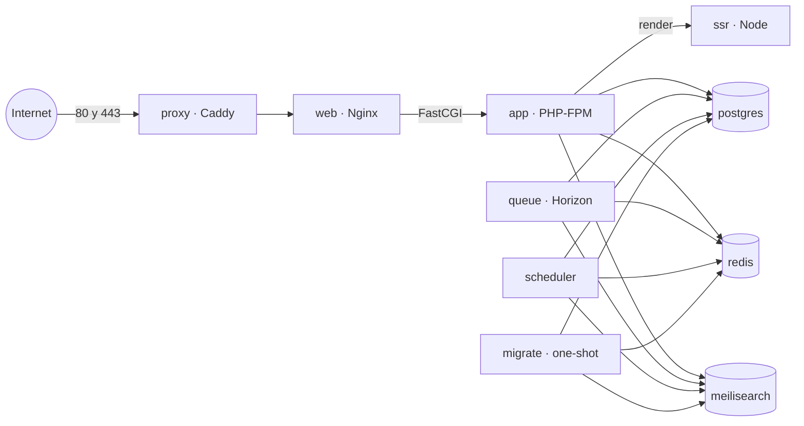

# Despliegue en producción

El foro se despliega con Docker Compose: `compose.prod.yaml` define los
servicios y `.env.production` su configuración. Esta guía cubre un servidor con
Docker; las imágenes son las mismas para cualquier otro orquestador.

## 1. Arquitectura



| Servicio | Imagen | Redes | Función |
|---|---|---|---|
| `proxy` | `caddy:2.11-alpine` | `edge` | HTTPS con certificados automáticos, HTTP/3, compresión y HSTS. El único que publica puertos (80 y 443) |
| `web` | `…-web` | `edge`, `app` | Nginx: `public/`, los assets compilados y los avatares; el resto, a `app` |
| `app` | `…-app` | `app`, `data` | PHP-FPM con Laravel |
| `ssr` | `…-ssr` | `app` | Servidor SSR de Inertia (Node) |
| `queue` | `…-app` | `app`, `data` | Horizon: las colas `default` y `ai` |
| `scheduler` | `…-app` | `app`, `data` | `schedule:work` |
| `migrate` | `…-app` | `app`, `data` | En cada despliegue, antes que nadie: migraciones y ajustes de los índices de Meilisearch |
| `postgres` | `pgvector/pgvector:pg18` | `data` | PostgreSQL 18 con pgvector |
| `redis` | `redis:8-alpine` | `data` | Caché, sesiones, colas y modo mantenimiento; con contraseña y AOF |
| `meilisearch` | `getmeili/meilisearch:v1.24` | `data` | Búsqueda, con clave maestra |

Las redes:

- `edge`: Internet, Caddy y Nginx.
- `app`: Nginx, PHP y SSR. Tiene salida a Internet porque PHP envía correo y
  llama a los proveedores de IA.
- `data`: los servicios de datos, **interna**: sin salida a Internet ni puertos
  publicados.

Los volúmenes con nombre guardan el estado: `storage` (los ficheros subidos,
como los avatares; Nginx lo monta en solo lectura), `postgres`, `redis`,
`meilisearch` y `caddy_data`/`caddy_config` (certificados y cuenta ACME).

Cada despliegue sigue este orden: los servicios de datos quedan sanos, `migrate`
termina con éxito, arrancan `app`, `queue` y `scheduler`, después `web` y por
último `proxy`. Si las migraciones fallan, no arranca nada que dependa de ellas.

## 2. Requisitos

- Un servidor Linux con **Docker Engine 25 o posterior y Docker Compose v2**.
  Para una comunidad pequeña bastan 2 vCPU y 4 GB de memoria.
- Un dominio cuyos registros DNS (A/AAAA) apunten al servidor, y abiertos los
  puertos 80/TCP y 443/TCP (y 443/UDP para HTTP/3).
- Un servidor SMTP para el correo.

## 3. Primer despliegue

**1. Los ficheros.** El servidor necesita `compose.prod.yaml`,
`docker/caddy/Caddyfile` y la plantilla del entorno; lo más sencillo es clonar
el repositorio:

```bash
git clone https://github.com/jaisato/laravel-forum.git
cd laravel-forum
cp .env.production.example .env.production
chmod 600 .env.production
```

**2. La configuración.** Completa `.env.production`; como mínimo:

| Variable | Valor |
|---|---|
| `SERVER_NAME` | El dominio, sin esquema (`foro.example.com`) |
| `ACME_EMAIL` | El email de la cuenta ACME de los certificados |
| `APP_URL` | `https://` y el dominio |
| `APP_KEY` | Una clave nueva (abajo) |
| `DB_PASSWORD`, `REDIS_PASSWORD`, `MEILISEARCH_KEY` | Secretos largos y aleatorios (la clave de Meilisearch, de 16 bytes o más) |
| `MAIL_*` | Tu servidor SMTP |
| `IMAGE_PREFIX`, `IMAGE_TAG` | De dónde vienen las imágenes y qué versión |

Para generar los secretos:

```bash
echo "base64:$(openssl rand -base64 32)"   # APP_KEY
openssl rand -hex 24                       # cada contraseña o clave
```

`compose.prod.yaml` lee `.env.production` dos veces: para sus propias variables
(`--env-file`) y como entorno de los contenedores de PHP. Para no repetir las
opciones, conviene un alias:

```bash
alias dcp='docker compose -f compose.prod.yaml --env-file .env.production'
```

**3. Las imágenes.** Descarga las publicadas en el registro de `IMAGE_PREFIX`,
o constrúyelas en el servidor desde el `Dockerfile` (ver la
[sección 8](#8-construir-las-imágenes)):

```bash
dcp pull    # imágenes publicadas
dcp build   # o construidas aquí
```

**4. El arranque.**

```bash
dcp up -d --wait
```

En el primer arranque Caddy obtiene el certificado: el DNS debe apuntar ya al
servidor y los puertos 80 y 443 deben estar abiertos.

**5. La primera cuenta de administración.** Regístrate en el foro y date el
rol:

```bash
dcp exec app php artisan forum:make-admin tu-email@example.com
```

**6. La comprobación.**

```bash
dcp ps
curl -fsS https://foro.example.com/up
```

Todos los servicios deben aparecer `healthy` salvo `migrate`, que termina con
`Exited (0)`.

## 4. Actualizar

```bash
# Nueva versión: IMAGE_TAG en .env.production y después
dcp pull
dcp up -d --wait
```

`up` recrea los contenedores cuya imagen cambió. `migrate` vuelve a ejecutarse
antes de que arranquen `app`, `queue` y `scheduler`; Horizon termina los
trabajos en curso antes de pararse (dispone de 200 s). Mientras se sustituye
`app` hay una breve interrupción: para migraciones largas, activa antes el modo
mantenimiento (`dcp exec app php artisan down`) y desactívalo al final
(`dcp exec app php artisan up`).

Volver a la versión anterior es poner su `IMAGE_TAG` y repetir `up`. Las
migraciones **no** se deshacen solas: escríbelas compatibles con la versión
anterior o restaura la copia de seguridad.

## 5. Operación diaria

| Tarea | Comando |
|---|---|
| Estado de los servicios | `dcp ps` |
| Logs | `dcp logs -f --tail=100 app queue` |
| Cualquier comando de Artisan | `dcp exec app php artisan about` |
| Estado de Horizon | `dcp exec queue php artisan horizon:status` |
| Trabajos fallidos | `dcp exec app php artisan queue:failed` y `dcp exec app php artisan queue:retry all` |
| Modo mantenimiento | `dcp exec app php artisan down` y `dcp exec app php artisan up` |
| Rehacer los índices de búsqueda | `dcp exec app php artisan scout:import "App\Models\Thread"` (y `"App\Models\Post"`) |

El modo mantenimiento se guarda en Redis (`APP_MAINTENANCE_DRIVER=cache`), así
que activarlo desde un contenedor afecta a todos. El panel de Horizon está en
`/horizon`, solo para la administración.

## 6. Copias de seguridad

**Base de datos.**

```bash
dcp exec -T postgres pg_dump -U forum -Fc forum > forum-$(date +%F).dump
```

Para restaurarla, para antes lo que escribe en ella:

```bash
dcp stop app queue scheduler
dcp exec -T postgres pg_restore -U forum -d forum --clean --if-exists --no-owner < forum-2026-10-23.dump
dcp start app queue scheduler
```

**Ficheros subidos** (el volumen `storage`; el prefijo es el nombre del
proyecto, `laravel-forum-prod`):

```bash
docker run --rm -v laravel-forum-prod_storage:/data:ro -v "$PWD":/backup alpine:3.24 \
    tar czf /backup/storage-$(date +%F).tgz -C /data .
docker run --rm -v laravel-forum-prod_storage:/data -v "$PWD":/backup alpine:3.24 \
    tar xzf /backup/storage-2026-10-23.tgz -C /data
```

**Lo demás.** Los índices de Meilisearch se rehacen desde la base de datos
(sección anterior). Redis guarda en su volumen los trabajos en cola; la caché y
las sesiones se pueden perder. Copia también el volumen `caddy_data` (evita
volver a pedir los certificados) y, sobre todo, `.env.production`: sin su
`APP_KEY` no se puede leer nada de lo que Laravel cifró.

## 7. Seguridad

- Solo Caddy publica puertos. **Nunca publiques el puerto del servicio `ssr`**:
  el servidor SSR de Inertia también atiende `/shutdown`.
- La red `data` es interna; todos los servicios tienen `no-new-privileges`,
  límites de recursos y rotación de logs; `web` y `ssr` corren con el sistema
  de ficheros en solo lectura.
- Las imágenes propias no se ejecutan como root (`www-data`, `nginx` y `node`).
- Caddy añade HSTS; Nginx, `X-Content-Type-Options`, `X-Frame-Options`,
  `Referrer-Policy` y `Permissions-Policy`, y no anuncia versiones.
- Laravel solo cree la IP y el esquema que llegan en `X-Forwarded-For`,
  `-Proto` y `-Port` cuando vienen de `TRUSTED_PROXIES` (las redes privadas de
  Docker, en la plantilla), y nunca `X-Forwarded-Host`.
- `.env.production` contiene todos los secretos: permisos `600` y fuera de git
  (`.gitignore` lo excluye). Para cambiar `APP_KEY` sin invalidar lo cifrado,
  deja la anterior en `APP_PREVIOUS_KEYS` hasta que ya no haga falta.

## 8. Construir las imágenes

`dcp build` construye `app`, `web` y `ssr` desde el `Dockerfile` y las etiqueta
como `${IMAGE_PREFIX}-app:${IMAGE_TAG}` (y `-web`, `-ssr`). El nombre que
aparece en los títulos de las páginas se fija al construir: es `APP_NAME`.

Con `docker build`, una imagen cada vez y **las tres con los mismos
argumentos**: `app` lleva el *manifest* de los assets que sirve `web`, y un
`VITE_APP_NAME` distinto cambiaría sus nombres:

```bash
docker build --target app --build-arg VITE_APP_NAME="Laravel Forum" -t ghcr.io/jaisato/laravel-forum-app:1.0.0 .
docker build --target web --build-arg VITE_APP_NAME="Laravel Forum" -t ghcr.io/jaisato/laravel-forum-web:1.0.0 .
docker build --target ssr --build-arg VITE_APP_NAME="Laravel Forum" -t ghcr.io/jaisato/laravel-forum-ssr:1.0.0 .
```

Si GitHub limita las descargas de Composer, pásale un token como secreto de
construcción (no queda en la imagen):

```bash
export COMPOSER_AUTH='{"github-oauth": {"github.com": "<token>"}}'
docker build --secret id=composer_auth,env=COMPOSER_AUTH --target app -t ghcr.io/jaisato/laravel-forum-app:1.0.0 .
```

## 9. Capacidad

- **PHP-FPM.** Cada proceso usa unos 50 MB. El tamaño del pool se ajusta con
  `PHP_FPM_PM_MAX_CHILDREN`, `PHP_FPM_PM_START_SERVERS`,
  `PHP_FPM_PM_MIN_SPARE_SERVERS`, `PHP_FPM_PM_MAX_SPARE_SERVERS` y
  `PHP_FPM_PM_MAX_REQUESTS` en `.env.production` (por defecto 20, 4, 2, 6 y
  1000).
- **Horizon.** Los procesos de cada supervisor de producción están en
  `config/horizon.php` (`environments.production`).
- **Límites de recursos.** `deploy.resources.limits` de cada servicio en
  `compose.prod.yaml`; ajústalos a la memoria del servidor. Son topes, no
  reservas.
